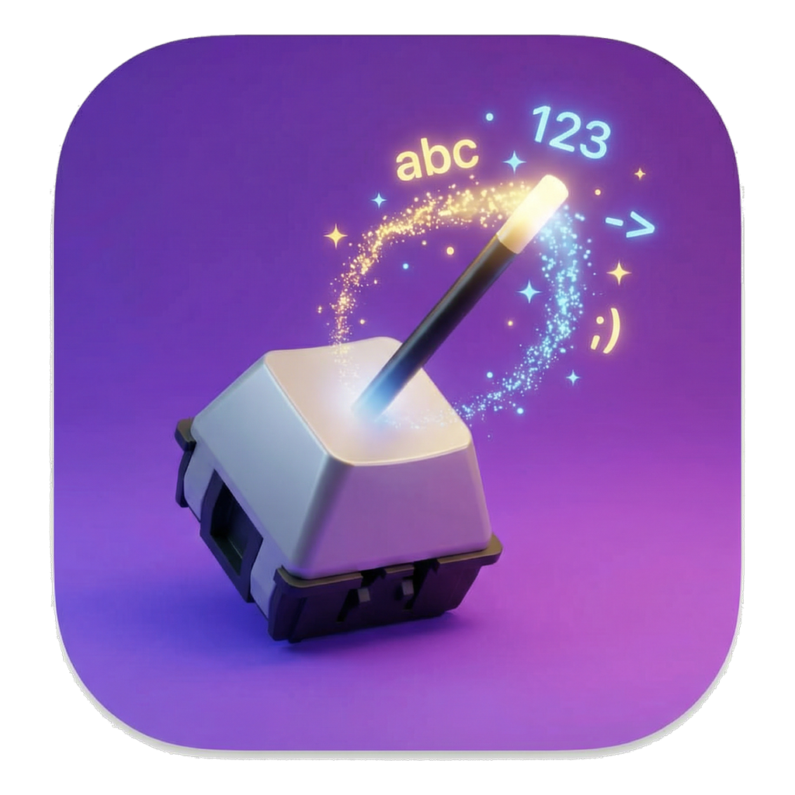

<p align="center">
  
</p>

<h1 align="center">Sokki</h1>

<p align="center">速記 — "shorthand". A menu bar text expander for macOS, written in Go. Its windows are
drawn by <a href="https://github.com/egoist/mygo">MyGo</a>'s native UI.</p>

## Features

- **Triggers anywhere:** type `:hello` in any app and it becomes `Hi there!`, with `{{clipboard}}` and
  `{{date:yyyy-MM-dd}}` variables
- **Undo:** backspace the whole expansion within 3 seconds and the trigger comes back
- **Overlapping triggers:** `;d` and `;done` both work: the shorter fires after a short pause
- **AI matches:** a `prompt:` with `{{selection}}` / `{{clipboard}}` runs through your Claude Code CLI and
  types the reply in place, with an animated placeholder and Esc to cancel
- **Palette:** a Spotlight-style finder of every match (⌥Space or another chord), ⌘↵ to edit
- **Recent Activity:** a HUD showing what was matched or blocked, to find out why a trigger didn't fire
- **Settings:** matches by file, with search, the editor, and the general, AI and privacy settings
- **Safe by default:** nothing is read in password fields (secure input), nothing typed is logged there
- **Auto-updates** with signed delta updates

## Configuration

Everything lives in `~/.config/sokki`, which the first launch creates:

```
config/default.yml   settings (enable, clipboard_threshold, inject_delay, palette_shortcut, ai: …)
match/*.yml          matches, in any number of files
logs/sokki.log       the log
```

```yaml
matches:
  - trigger: ":sig"
    replace: |
      Best regards,
      Your Name
  - trigger: ":fix"
    label: Fix grammar
    prompt: "Fix the grammar, keep the tone: {{s|c}}"
```

Files are reloaded as they change.

## Requirements

- macOS 14 or later, Apple silicon
- The Accessibility permission, which Sokki asks for at first launch
- For AI matches, the [Claude Code CLI](https://docs.claude.com/en/docs/claude-code)

## Development

```sh
scripts/dev.sh                  # run Sokki, rebuilt as sources change, with matches in ~/.config/sokki-dev
go test ./...                   # tests, the views headless
go tool mygo build              # build build/darwin-arm64/Sokki.app and a .dmg, signed ad hoc
```

See [CONTRIBUTING.md](CONTRIBUTING.md) to release, and
[docs/designs/2026-10-16-mygo-rewrite.md](docs/designs/2026-10-16-mygo-rewrite.md) for how it works.
